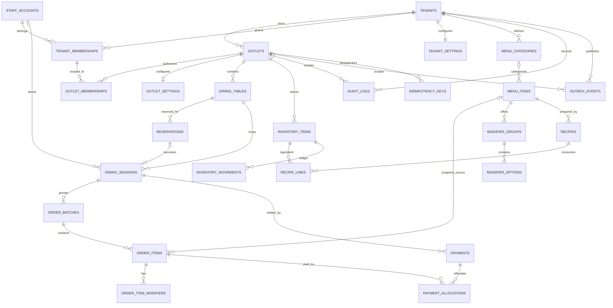

# Gastro-Cashier — PostgreSQL 15 ERD

> Baseline relational model for multi-tenant, multi-outlet POS. `schema.sql` is the canonical DDL. Operational data is tenant-scoped; outlet-owned records carry both `tenant_id` and `outlet_id` and use composite foreign keys to prevent cross-outlet references.

## Entity relationship diagram



## Table catalogue

| Domain | Tables | Purpose |
|---|---|---|
| Tenant & access | `tenants`, `outlets`, `staff_accounts`, `tenant_memberships`, `outlet_memberships` | Identity, tenant selection, outlet authorization, account status |
| Configuration | `tenant_settings`, `outlet_settings` | Tax/service rates and payment-flow defaults |
| Floor & reservation | `dining_tables`, `reservations`, `dining_sessions` | Table state, reservation gate, one active session per table |
| Menu | `menu_categories`, `menu_items`, `modifier_groups`, `modifier_options` | Tenant/outlet-aware menu catalogue and modifiers |
| Ordering | `order_batches`, `order_items`, `order_item_modifiers` | Shared session workspace and monotonic order batches |
| Payment | `payments`, `payment_allocations` | Cash/QRIS/card settlement, partial and payment-first allocation |
| Inventory | `inventory_items`, `recipes`, `recipe_lines`, `inventory_movements` | Stock ledger and recipe consumption |
| Reliability & audit | `audit_logs`, `outbox_events`, `idempotency_keys` | Append-only audit, offline sync outbox, retry-safe commands |

## Key integrity rules

1. **Tenant/outlet boundary:** composite foreign keys require related rows to share the same tenant and outlet. RLS additionally requires request-local `app.tenant_id` and `app.outlet_id`.
2. **One open session per table:** partial unique index `uq_one_open_session_per_table` prevents two active/billing sessions on one table when two cashiers act simultaneously.
3. **Session version:** `dining_sessions.version` is an optimistic concurrency token. Mutations should compare the expected version and increment it in the same SQL transaction.
4. **Order sequence:** unique `(tenant_id, outlet_id, session_id, batch_number)` prevents duplicate batch numbers. Allocate the next number while locking the session row with `SELECT ... FOR UPDATE`.
5. **Payment idempotency:** payment `idempotency_key` is unique per outlet. A retry must return the original result, not create another receipt.
6. **Payment-first / partial payment:** `payment_allocations` associates a payment with exact order items. The backend must lock items and reject over-allocation.
7. **Audit immutability:** a trigger rejects UPDATE and DELETE on `audit_logs`. The production runtime role should also receive INSERT and SELECT only.
8. **Table state:** `v_table_board` derives available/occupied/billing from sessions. Do not maintain a second writable table-status field.
9. **Reservations:** server-side authorization is required before converting a reservation into a dining session. The unique open-session index remains the concurrency guard.

## Session transaction pattern

```sql
BEGIN;
SELECT set_config('app.tenant_id', :tenant_id, true);
SELECT set_config('app.outlet_id', :outlet_id, true);
SELECT id, version
FROM dining_sessions
WHERE id = :session_id
FOR UPDATE;
-- Verify outlet membership and expected version, then write batch/items.
UPDATE dining_sessions
SET version = version + 1
WHERE id = :session_id AND version = :expected_version;
COMMIT;
```

## Runtime and migration notes

- This schema is a database foundation, not a completed API integration. The server must authenticate PIN/NFC credentials, resolve active tenant/outlet memberships, set RLS context in each transaction, and never trust tenant/outlet IDs supplied only by the browser.
- Use a dedicated non-owner runtime role without BYPASSRLS. Table owners and superusers can bypass ordinary RLS.
- PIN/NFC secrets must be hashed server-side using a slow password KDF (Argon2id preferred). Never store raw PINs, NFC UIDs, or peppers.
- The schema is intended for an empty database. Existing localStorage data requires an explicit tenant-aware import and mapping.
- The previous single-restaurant reverse-engineered schema is superseded by this ERD and `schema.sql`.
