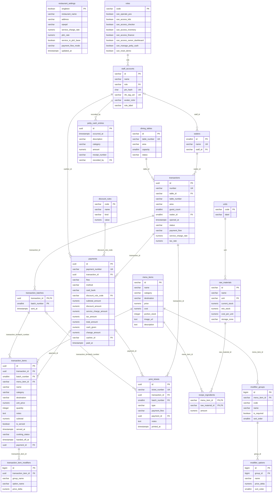

# ERD Gastro-Cashier (RestoPOS Touch)

> Dibuat otomatis oleh `db/tools/generate-erd.ts` dari skema yang dimuat ke PostgreSQL. Jangan diubah manual; ubah `db/schema.sql` lalu jalankan `db/tests/run.sh`.

Aplikasi saat ini hanya front-end (data di localStorage). Skema ini adalah bentuk relasional dari data itu: **19 tabel**, **21 relasi**, **8 view**.

Notasi: `||` tepat satu, `|o` nol atau satu, `o{` nol atau banyak. Ujung induk ada di kiri. Kolom hanya diberi tanda PK, FK, UK; tipe lengkap, default, dan CHECK ada di [DATA_DICTIONARY.md](DATA_DICTIONARY.md).

## Daftar relasi

| Induk | Anak | Kolom FK | Kardinalitas (induk : anak) | ON DELETE |
| --- | --- | --- | --- | --- |
| menu_items (id) | modifier_groups | menu_item_id | 1 : 0..N | CASCADE |
| modifier_groups (id) | modifier_options | group_id | 1 : 0..N | CASCADE |
| staff_accounts (id) | payments | cashier_id | 1 : 0..N | NO ACTION |
| discount_rules (code) | payments | discount_rule_code | 0..1 : 0..N | NO ACTION |
| transactions (id) | payments | transaction_id | 1 : 0..N | NO ACTION |
| staff_accounts (id) | petty_cash_entries | recorded_by | 1 : 0..N | NO ACTION |
| transaction_batches (transaction_id, batch_number) | print_tickets | transaction_id, batch_number | 0..1 : 0..N | NO ACTION |
| payments (id) | print_tickets | payment_id | 0..1 : 0..N | NO ACTION |
| transactions (id) | print_tickets | transaction_id | 1 : 0..N | CASCADE |
| units (code) | raw_materials | unit | 1 : 0..N | NO ACTION |
| menu_items (id) | recipe_ingredients | menu_item_id | 1 : 0..N | CASCADE |
| raw_materials (id) | recipe_ingredients | raw_material_id | 1 : 0..N | RESTRICT |
| roles (code) | staff_accounts | role | 1 : 0..N | NO ACTION |
| transactions (id) | transaction_batches | transaction_id | 1 : 0..N | CASCADE |
| transaction_items (id) | transaction_item_modifiers | transaction_item_id | 1 : 0..N | CASCADE |
| transaction_batches (transaction_id, batch_number) | transaction_items | transaction_id, batch_number | 1 : 0..N | CASCADE |
| menu_items (id) | transaction_items | menu_item_id | 1 : 0..N | NO ACTION |
| payments (id) | transaction_items | payment_id | 0..1 : 0..N | NO ACTION |
| dining_tables (id) | transactions | table_id | 1 : 0..N | NO ACTION |
| waiters (id) | transactions | waiter_id | 1 : 0..N | NO ACTION |
| staff_accounts (id) | waiters | staff_id | 0..1 : 0..N | NO ACTION |

## View turunan

Field di `src/types/pos.ts` yang sengaja tidak disimpan sebagai kolom karena bisa dihitung.

| View | Fungsi |
| --- | --- |
| v_daily_settlement | Rekap harian: omzet, service charge, PB1, diskon, rincian per metode bayar (calculateFinanceMetrics). |
| v_integrity_item_subtotal | Pemeriksaan: subtotal item harus sama dengan (harga + modifier) x jumlah. Harus kosong. |
| v_integrity_payment | Pemeriksaan: subtotal, diskon, service charge, dan PB1 pada pembayaran harus sama dengan hitung ulang. Harus kosong. |
| v_kds_active_items | Antrean KDS: item yang belum dilayani dan belum diserahkan ke pramusaji (isKdsItemActive). |
| v_stock_status | Status stok dan nilai aset per bahan baku (buildInventorySheetRows). |
| v_table_board | Field runtime Table (currentTransactionId, guestCount, openedAt, waiterName) dan status meja beserta bill aktifnya. |
| v_transaction_summary | Transaction.isPaid, subtotal item, jumlah dibayar dan sisa tagihan per transaksi. |
| v_waiter_pickup_items | Item yang sudah selesai di KDS dan menunggu dicentang pramusaji (isItemWaitingForWaiter). |
